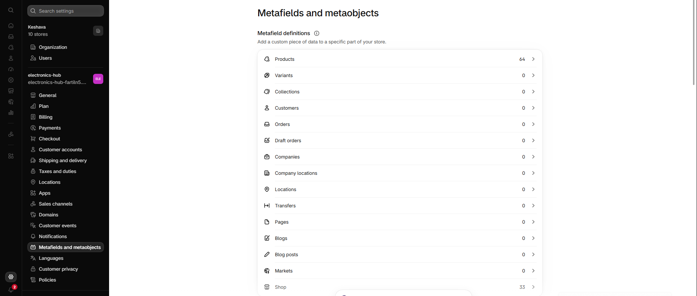
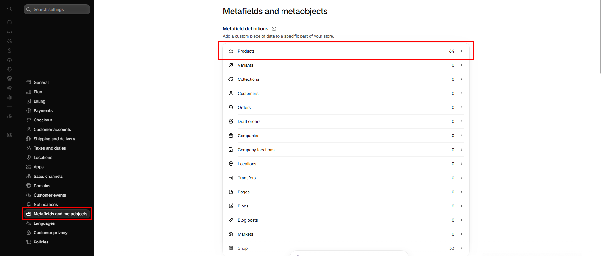
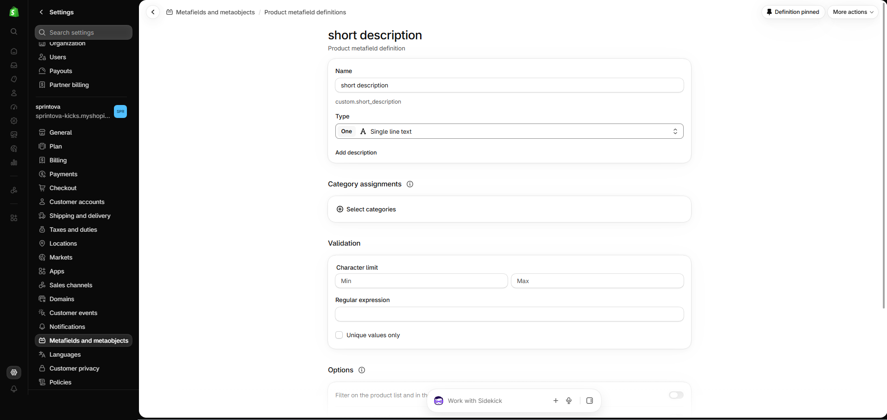
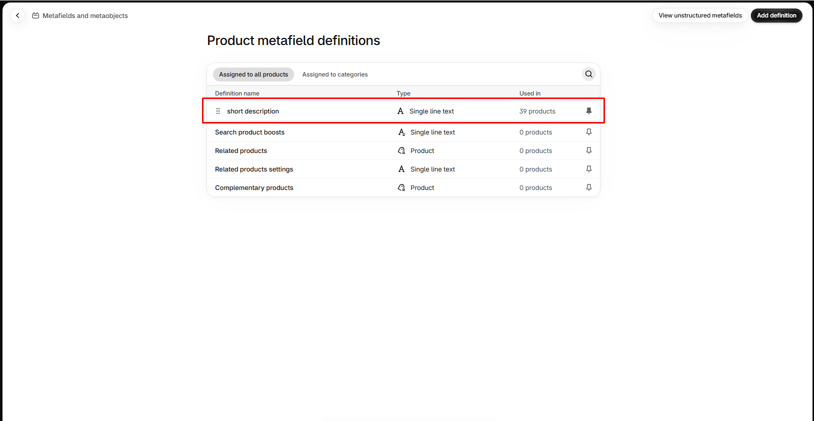
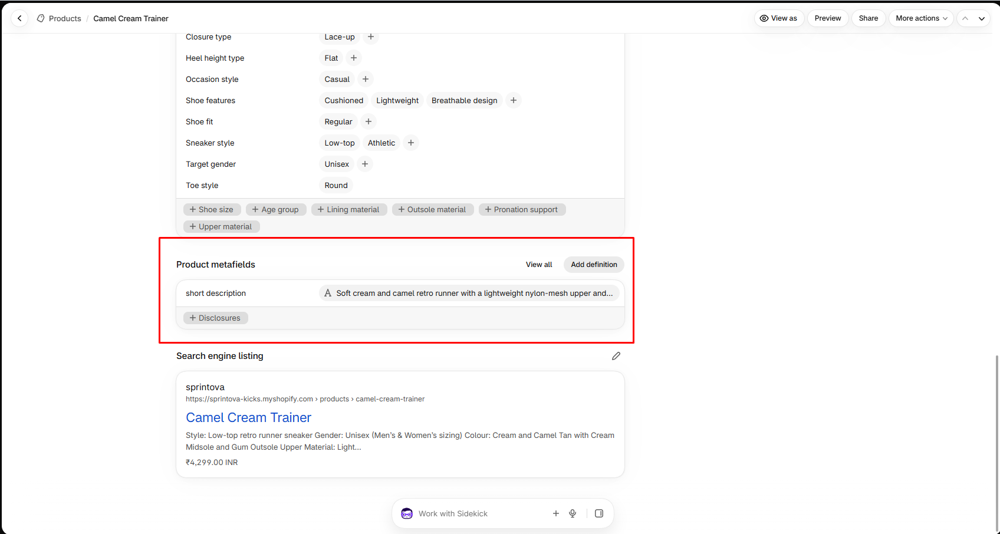
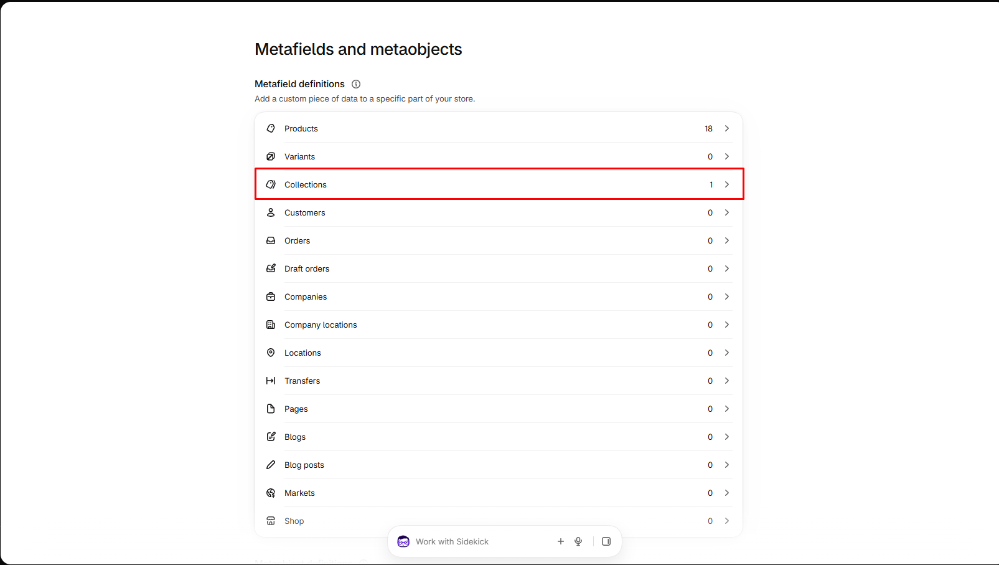
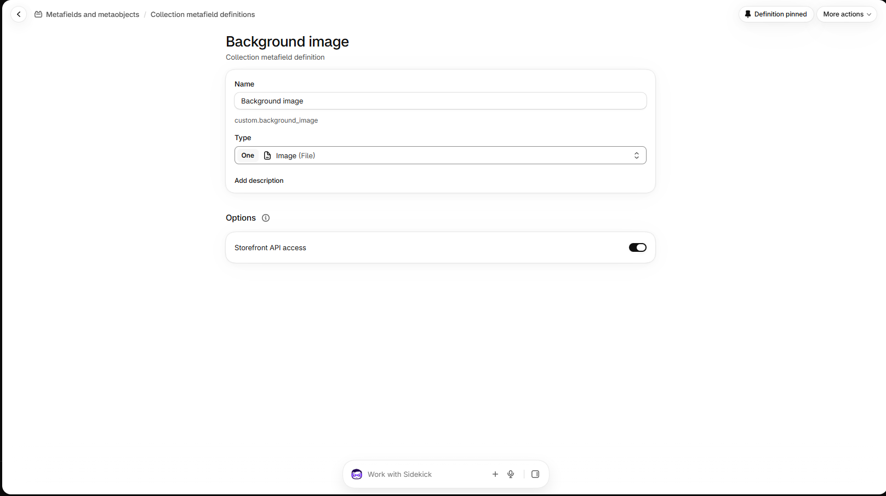
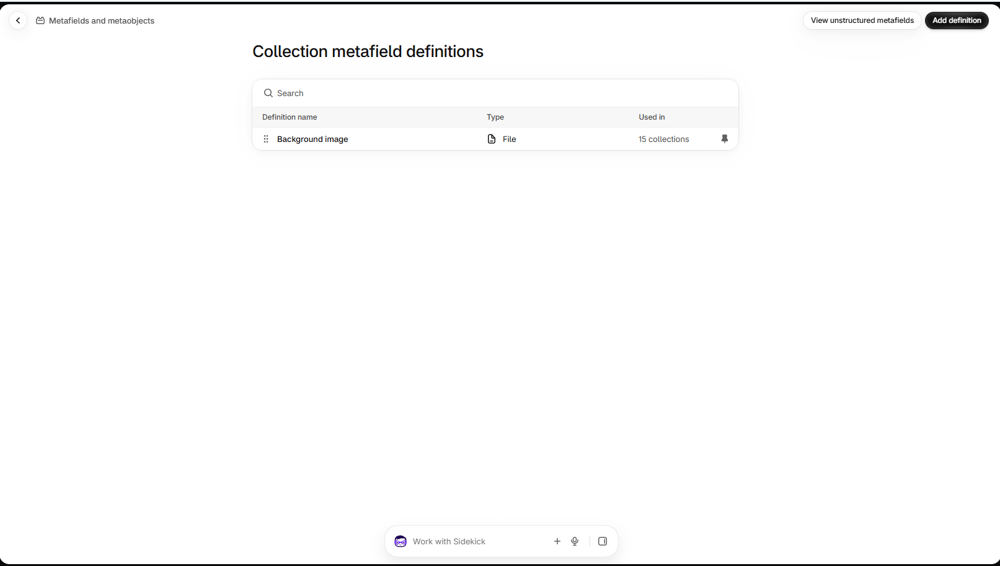

# Metafields

Metafields store extra data that the theme can display. Shopify keeps product metafields and collection metafields in separate lists, so this page covers each one on its own.

Each type follows the same three stages:

1. **Create the definition** (once, in Settings).
2. **Add the values** (on each product or collection).
3. **Map it in the theme** (in the theme editor, so it shows on the storefront).

***

## Product metafields

The Sprintova theme reads the product metafields below.

| Metafield | Used for |
| --------- | -------- |
| `custom.short_description` | Product description text shown in the **Featured product information** section on the home page.


The `reviews.*` metafields are created and filled by the Judge.me app. Do not edit them manually.


### How to create a product metafield definition

| Step | Action |
| ---- | ------ |
| 1 | Go to **Shopify Admin → Settings**. |
| 2 | Click **Metafields and metaobjects**. |
| 3 | Click **Products**. |
| 4 | Click **Add definition**. |
| 5 | Configure the definition. **Name:** A descriptive label, for example `Short description`. The namespace and key are generated (for example `custom.short_description`). **Type:** Type of data to store, such as Single line text, Multi-line text, Rich text, Number, URL, File, Date, Color, or Boolean. **Description:** Optional internal notes about the metafield. |
| 6 | Click **Save**. |

## Step 1

## Step 2

## Step 3

## Step 4

### How to add product metafield values

| Step | Action |
| ---- | ------ |
| 1 | Go to **Shopify Admin → Products** and open the product. |
| 2 | Scroll down to the **Metafields** section. |
| 3 | Enter the required value. |
| 4 | Click **Save**. |

### How to map a product metafield in the theme

Do this after the definition exists and at least one product has a value.

| Step | Action |
| ---- | ------ |
| 1 | Go to **Shopify Admin → Online Store → Themes** and click **Customize**. |
| 2 | In the page picker at the top, choose **Products → Default product**. |
| 3 | Select the **text block** where the value should appear (or add one with **Add block → Text**). |
| 4 | In the text field, click the **Insert dynamic source** icon. |
| 5 | Choose your **product metafield** from the list. |
| 6 | Click **Save**. |


The list only shows metafields whose type fits the field. A Single line text metafield appears for text fields, and a Rich text metafield appears for rich text fields. If your metafield is missing, check its type in the definition.



`custom.short_description` is read automatically by the **Featured product information** section on the home page. You only need to create it and fill it on each product.


***

## Collection metafields

The Sprintova theme does not read any collection metafields by default. Create one only when you want to show extra collection information of your own, such as a short tagline or a size guide note.


The names used below, such as `custom.collection_tagline`, are examples. Use any name that suits your store.


### How to create a collection metafield definition

| Step | Action |
| ---- | ------ |
| 1 | Go to **Shopify Admin → Settings**. |
| 2 | Click **Metafields and metaobjects**. |
| 3 | Click **Collections**. |
| 4 | Click **Add definition**. |
| 5 | Configure the definition. **Name:** A descriptive label, for example `Background image`. The namespace and key are generated (for example `custom.background_image`). **Type:** Type of data to store, such as Single line text, Multi-line text, Rich text, Number, URL, File, or Boolean. **Description:** Optional internal notes about the metafield. |
| 6 | Click **Save**. |

## Step 1

## Step 2

## Step 3

### How to add collection metafield values

| Step | Action |
| ---- | ------ |
| 1 | Go to **Shopify Admin → Products → Collections** and open the collection. |
| 2 | Scroll down to the **Metafields** section. |
| 3 | Enter the required value. |
| 4 | Click **Save**. |

### How to map a collection metafield in the theme

Do this after the definition exists and at least one collection has a value.

| Step | Action |
| ---- | ------ |
| 1 | Go to **Shopify Admin → Online Store → Themes** and click **Customize**. |
| 2 | In the page picker at the top, choose **Collections → Default collection**. |
| 3 | Select the **text block** where the value should appear (or add one with **Add block → Text**). |
| 4 | In the text field, click the **Insert dynamic source** icon. |
| 5 | Choose your **collection metafield** from the list. |
| 6 | Click **Save**. |


The value shows only on collections that have it filled in. Collections with an empty value show nothing in that block.
