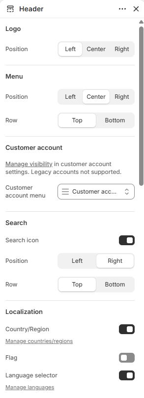
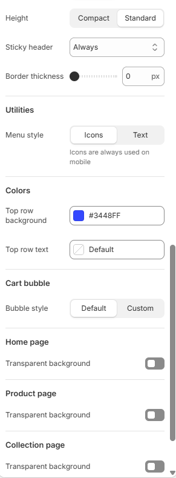
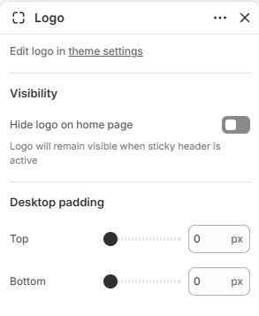
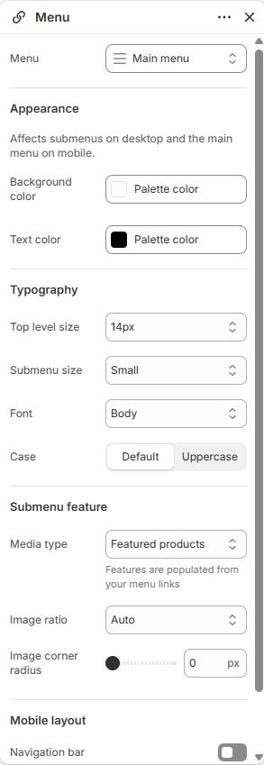
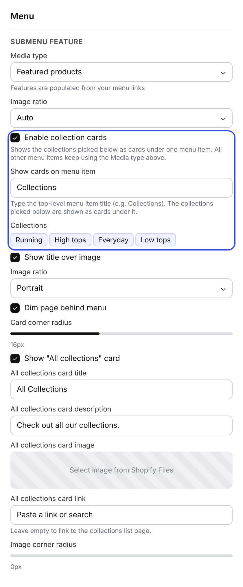
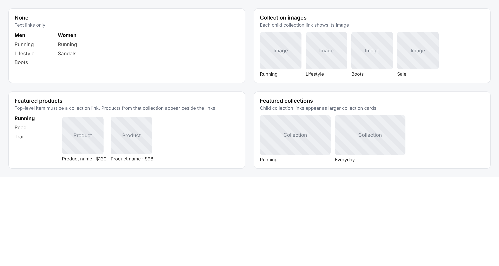
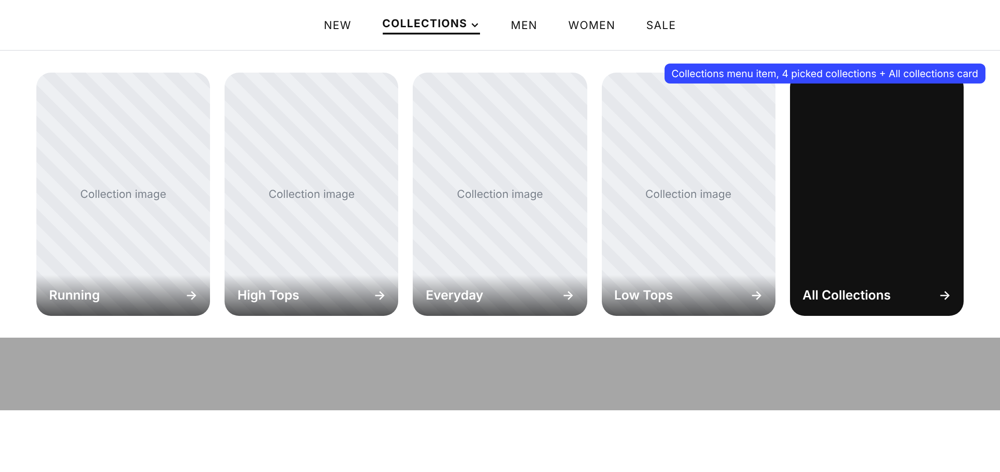
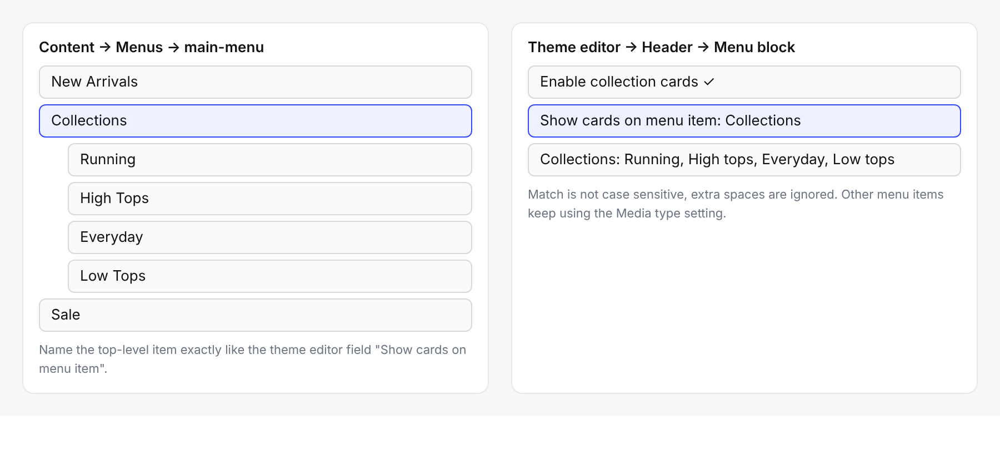

# Header

Displays the logo, main menu, search, account, cart, and country or language selectors.

## How to access

1. **Go to** Shopify Admin → Online Store → Themes.
2. **Click** Customize on your active theme.
3. Open the **Header** group in the sidebar and select **Header**.

### Section Settings

| Setting | Description |
| ------- | ----------- |
| Logo |  |
| Position | Sets the position for logo. Choose from Left, Center, or Right. |
| Menu |  |
| Position | Sets the position for menu. Choose from Left, Center, or Right. |
| Row | Sets the row for menu. Choose from Top or Bottom. |
| Customer account |  |
| Customer account menu | Selects the menu to display. |
| Account icon | Selects an image to use as the account icon. |
| Search |  |
| Search icon | Enables or disables search icon. |
| Position | Sets the position for search. Choose from Left or Right. |
| Row | Sets the row for search. Choose from Top or Bottom. |
| Localization |  |
| Country/Region | Enables or disables country/Region. Manage countries/regions. |
| Flag | Enables or disables flag. |
| Language selector | Enables or disables language selector. Manage languages. |
| Font | Sets the font for localization. Choose from Heading, Subheading, Body, or Accent. |
| Size | Sets the size for localization. Choose from 10px, 12px, 14px, 16px, or 18px. |
| Position | Sets the position for localization. Choose from Left or Right. |
| Row | Sets the row for localization. Choose from Top or Bottom. |
| Appearance |  |
| Width | Sets the width for appearance. Choose from Page or Full. |
| Height | Sets the height for appearance. Choose from Compact or Standard. |
| Sticky header | Sets the sticky header. Choose from Always, On scroll up, or Never. |
| Divider thickness | Sets the divider thickness. Range: 0–5 px. |
| Divider width | Sets the divider width. Choose from Page or Full. |
| Divider color | Sets the divider color. |
| Border thickness | Sets the border thickness. Range: 0–5 px. |
| Bottom border color | Sets the bottom border color. |
| Utilities |  |
| Menu style | Sets the menu style. Choose from Icons or Text. Icons are always used on mobile. |
| Size | Sets the size for utilities. Choose from 12px, 14px, 16px, or 18px. |
| Font | Sets the font for utilities. Choose from Heading, Subheading, Body, or Accent. |
| Case | Sets the case for utilities. Choose from Default or Uppercase. |
| Colors |  |
| Top row background | Sets the top row background color. |
| Top row text | Sets the top row text color. |
| Bottom row background | Sets the bottom row background color. |
| Bottom row text | Sets the bottom row text color. |
| Cart bubble |  |
| Bubble style | Sets the bubble style. Choose from Default or Custom. |
| Background | Sets the cart bubble background color. |
| Text | Sets the cart bubble text color. |
| Home page |  |
| Transparent background | Enables or disables transparent background. |
| Inverse logo | Enables or disables inverse logo. |
| Transparent header text | Sets the home page transparent header text color. |
| Product page |  |
| Transparent background | Enables or disables transparent background on product pages. |
| Inverse logo | Enables or disables inverse logo on product pages. |
| Transparent header text | Sets the product page transparent header text color. |
| Collection page |  |
| Transparent background | Enables or disables transparent background on collection pages. |
| Inverse logo | Enables or disables inverse logo on collection pages. |
| Transparent header text | Sets the collection page transparent header text color. |

### Blocks

Add blocks to this section in the theme editor. Each block is a separate item you can add, remove, and reorder.

#### Logo

Displays the store logo in the header.

| Setting | Description |
| ------- | ----------- |
| Visibility |  |
| Hide logo on home page | Turn on to hide logo on home page. Logo will remain visible when sticky header is active. |
| Desktop padding |  |
| Top | Sets the top for desktop padding. Range: 0–100 px. |
| Bottom | Sets the bottom for desktop padding. Range: 0–100 px. |

#### Menu

Displays the main navigation menu in the header.

| Setting | Description |
| ------- | ----------- |
| Menu | Selects the menu to display. |
| Appearance |  |
| Background color | Sets the background color. |
| Text color | Sets the text color. |
| Typography |  |
| Top level size | Sets the top level size. Choose from 10px, 12px, 14px, 16px, or 18px. |
| Submenu size | Sets the submenu size. Choose from Small, Medium, or Large. |
| Font | Sets the font for typography. Choose from Body, Subheading, Heading, or Accent. |
| Case | Sets the case for typography. Choose from Default or Uppercase. |
| Submenu feature |  |
| Media type | Sets what the submenu shows next to the links. Choose from None, Collection images, Featured products, or Featured collections. Features are populated from your menu links. See [Submenu feature](#submenu-feature-mega-menu). |
| Image ratio | Shown for Featured products. Choose from Auto, Portrait, or Square. |
| Image ratio | Shown for Featured collections. Choose from Auto, Landscape, or Square. |
| Enable collection cards | Shows the collections picked below as image cards under one menu item. All other menu items keep using the Media type above. |
| Show cards on menu item | Type the top-level menu item title (for example Collections). The cards appear under that item only. |
| Collections | Picks up to 5 collections to show as cards. If none are picked, the child links of the menu item are used on desktop. |
| Show title over image | Turn on to place the card title over the image. |
| Image ratio | Sets the card image ratio. Choose from Auto, Portrait, Square, or Landscape. |
| Dim page behind menu | Turn on to dim the page while the submenu is open. |
| Card corner radius | Sets the card corner radius. Range: 0–40 px. |
| Show "All collections" card | Turn on to add a dark card at the end that links to all collections. |
| All collections card title | Sets the title of the card. |
| All collections card description | Sets the description of the card. |
| All collections card image | Selects the card image. If empty, the first picked collection's image is used. |
| All collections card link | Sets the link. Leave empty to link to the collections list page. |
| Image corner radius | Sets the image corner radius for Collection images, Featured products and Featured collections. Range: 0–32 px. |
| Mobile layout |  |
| Navigation bar | Enables or disables navigation bar. |
| Navigation bar background color | Sets the navigation bar background color. |
| Navigation bar text color | Sets the navigation bar text color. |
| Accordion | Enables or disables accordion. |
| Expand first group | Turn on to expand first group. |
| Dividers | Enables or disables dividers. |

### Submenu feature (mega menu)

The submenu opens when a top-level menu item has child items. The **Submenu feature** settings of the Menu block decide what visuals appear inside it. Build the menu itself in **Content → Menus** (see [How to create a menu](../how-to-create/how-to-create-a-menu.md)).

#### Media type

| Media type | What shows | Menu requirement |
| ---------- | ---------- | ---------------- |
| None | Text links only. | Nested child links. |
| Collection images | Each child link shows its collection image above the title. | Child links must be collections (or Catalog/Collections links). |
| Featured products | Products appear beside the links. | The top-level item must be a Collection, Catalog, or Collections link. |
| Featured collections | Child collections appear as larger collection cards beside the links. | The top-level item or its children must be collection links. |

If the menu does not meet the requirement, the submenu falls back to text links.

#### Collection cards

Use collection cards for a visual "Collections" mega menu. It works on one menu item only; every other item keeps the Media type above.

1. In **Content → Menus**, create a top-level item named **Collections**. Nesting child items under it is optional.

   
2. In the theme editor open **Header → Menu** block and turn on **Enable collection cards**.
3. In **Show cards on menu item** type the same name, for example `Collections`. The match ignores capital letters and extra spaces.
4. Under **Collections** pick up to 5 collections. Each shows its featured image (or its first product's image) and its title.
5. Adjust **Image ratio**, **Card corner radius**, **Show title over image**, and **Dim page behind menu**.
6. Keep **Show "All collections" card** on to add the dark last card. Set its title, image, and link. Leave the link empty to open the collections list page.

Notes:

- On desktop, if no collections are picked, the child links of the menu item become the cards.
- On mobile the cards show in the menu drawer as a 2-column grid, and only when collections are picked.
- Cards use up to 6 columns, counting the All collections card.

#### Using other media types in the same menu

Set **Media type** for all other items, for example **Featured products** for a "Running" item that links to a collection, or **Collection images** for an item whose children are collections. Only the item named in **Show cards on menu item** switches to cards.
