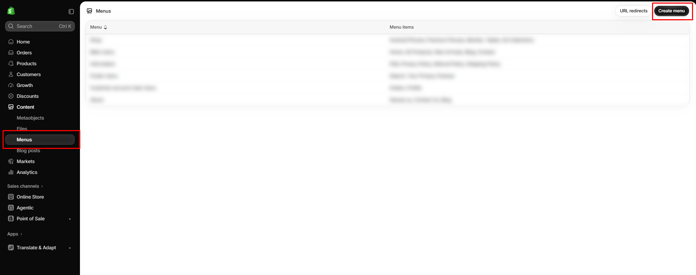
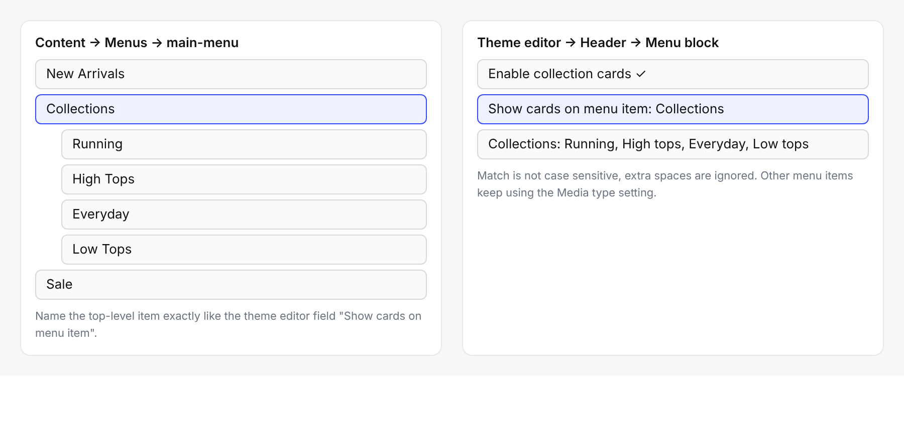

# How to create a menu

Build the navigation shown in the header and footer.

## How to access

1. **Go to** Shopify Admin → **Content** → **Menus**.
2. Click **Create menu** and enter a **Title**.
3. Click **Add menu item**, enter a name, and choose where it links (collection, product, page, or URL).
4. Drag items to reorder them, or nest an item under another to create a dropdown.
5. Click **Save**.

## Menus used on this store

| Menu | Used in |
| ---- | ------- |
| `main-menu` | Header menu |
| `shop` | Footer column **SHOP** |
| `about` | Footer column **ABOUT** |
| `information` | Footer column **INFORMATION** |
| `customer-account-main-menu` | Account menu in the header |

To change which menu a block shows, open the block in the theme editor and use its **Menu** setting.

## Menu for the mega menu with images

The submenu look is set in the theme editor (**Header → Menu** block → **Submenu feature**), but it depends on how the menu is built.

| Goal | How to build the menu |
| ---- | --------------------- |
| Collection images | Add a top-level item, nest collection links under it, and set **Media type** to **Collection images**. |
| Featured products | Link the top-level item to a collection, nest child links under it, and set **Media type** to **Featured products**. |
| Featured collections | Link the top-level item to a collection (or Catalog), nest collection links, and set **Media type** to **Featured collections**. |
| Collection cards | Add a top-level item named **Collections** and turn on **Enable collection cards**. Type the same name in **Show cards on menu item** and pick the collections. |

See [Header → Submenu feature](../header/header.md#submenu-feature-mega-menu) for every setting.
