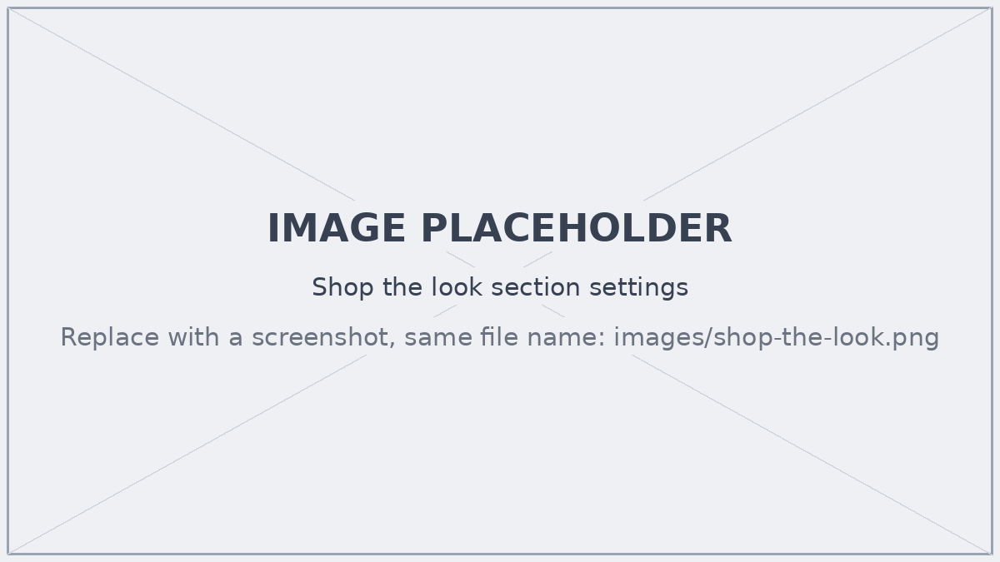
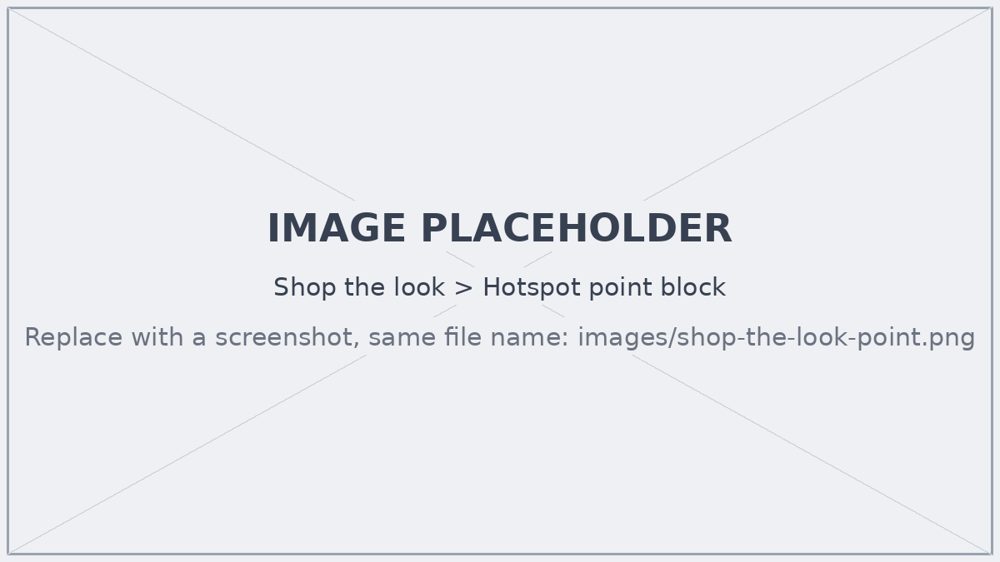

# Shop the look

Displays a lifestyle image with hotspots and a product slider beside it, so shoppers can discover and shop every item in the look.

## How to access

1. **Go to** Shopify Admin → Online Store → Themes.
2. **Click** Customize on your active theme.
3. Open a page such as **Home page** from the page picker.
4. Click **Add section** and choose **Shop the look**, or select an existing Shop the look section.

### Section Settings

| Setting | Description |
| ------- | ----------- |
| Content |  |
| Heading | Sets the heading shown beside the image. Default: Shop the look. |
| Image | Selects the image the hotspots sit on. |
| Image height | Sets the image height. Choose from Match image, Landscape (16:9), Landscape (16:10), Standard (4:3), Square (1:1), Portrait (4:5), or Portrait (3:4). |
| Section layout |  |
| Width | Sets the width. Choose from Page or Full. |
| Gap between image and slider | Sets the gap between the image and the product slider. Range: 8–80 px. |
| Corner radius | Sets the corner radius. Range: 0–40 px. |
| Colors |  |
| Accent (active hotspot) | Sets the color of the hotspot that is currently selected. |
| Hotspot color | Sets the hotspot color. Supports transparency. |
| Inner color | Sets the color of the dot inside the hotspot. |
| Background color | Sets the background color. |
| Dots |  |
| Dot outside | Sets the outer size of the hotspot. Range: 35–80 px. |
| Dot inside | Sets the inner size of the hotspot. Range: 15–60 px. |
| Padding |  |
| Top | Sets the top padding. Range: 0–100 px. |
| Bottom | Sets the bottom padding. Range: 0–100 px. |


On desktop the image sits on the left and the product slider on the right. Hovering a hotspot slides to its product card, and clicking a hotspot opens quick view for that product. On mobile the layout stacks: heading, image, product card, and pagination dots. You can add up to 8 hotspot points.


### Blocks

Add blocks to this section in the theme editor. Each block is a separate item you can add, remove, and reorder.

#### Hotspot point

Adds a hotspot on the image and a product card in the slider.

| Setting | Description |
| ------- | ----------- |
| Product | Selects the product shown in the slider card for this hotspot. |
| Horizontal position | Sets the horizontal position of the hotspot on the image. Range: 0–100%. |
| Vertical position | Sets the vertical position of the hotspot on the image. Range: 0–100%. |

Each hotspot point holds the product card that appears in the slider. Inside the point you can add, remove, and reorder these blocks: **Product image**, **Product title**, **Price**, **Swatches**, **Review stars**, **Text**, and **Custom liquid**. See Theme blocks for their settings.
