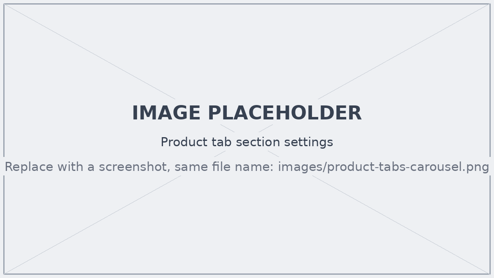
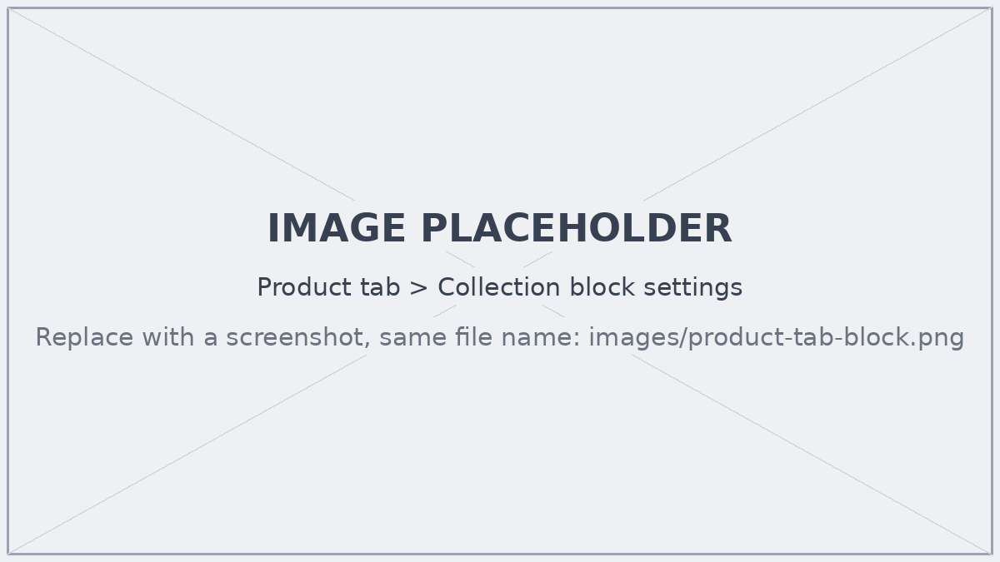

# Product tab

Displays products in tabs. Each tab shows one collection, with an optional banner card in front of the products, in a scrollable carousel.

## How to access

1. **Go to** Shopify Admin → Online Store → Themes.
2. **Click** Customize on your active theme.
3. Open a page such as **Home page** from the page picker.
4. Click **Add section** and choose **Product tab**, or select an existing Product tab section.

### Section Settings

| Setting | Description |
| ------- | ----------- |
| Products |  |
| Products per tab | Sets how many products each tab shows. Range: 2–16. |
| Cards per row (desktop) | Sets how many cards fit in a row on desktop. Range: 2–6. The banner counts as one card. |
| Cards per row (mobile) | Sets the card size on mobile. Choose from 1 card, next one peeks or 2 cards. |
| Gap between cards | Sets the gap between cards. Range: 0–48 px. |
| Banner card |  |
| Show banner card | Shows or hides the banner card before the products. |
| Corner radius | Sets the banner corner radius. Range: 0–32 px. |
| Image darkening | Sets how much the banner image is darkened so the text stays readable. Range: 0–80%. |
| Text color | Sets the banner text color. |
| Product tab button |  |
| Active tab | Sets the background color of the selected tab. |
| Text | Sets the tab text color. |
| Border | Sets the tab border color. |
| Banner heading typography |  |
| Preset | Sets the banner heading typography preset. Choose from Heading 1, Heading 2, Heading 3, Heading 4, Heading 5, Heading 6, or Custom. Edit presets in theme settings. |
| Font | Sets the font. Choose from Body, Subheading, Heading, or Accent. Available when Preset is Custom. |
| Size | Sets the size. Choose from Default, 12px, 14px, 16px, 18px, 20px, 24px, 32px, 40px, 48px, 56px, or 72px. Available when Preset is Custom. |
| Line height | Sets the line height. Choose from Tight, Normal, or Loose. Available when Preset is Custom. |
| Letter spacing | Sets the letter spacing. Choose from Tight, Normal, or Loose. Available when Preset is Custom. |
| Case | Sets the case. Choose from Default or Uppercase. Available when Preset is Custom. |
| Wrap | Sets the text wrap. Choose from Pretty, Balance, or No wrap. Available when Preset is Custom. |
| Carousel navigation |  |
| Icon | Sets the navigation icon. Choose from Arrows, Chevrons, Large arrows, Large chevrons, or None. |
| Icon background | Sets the icon background. Choose from None, Circle, or Square. Not shown when Icon is None. |
| Navigation |  |
| Show scroll progress bar | Shows or hides the scroll progress bar under the carousel. |
| Show "View all" link | Shows or hides the "View all" link next to the tabs. The link always points to the collection of the selected tab. |
| "View all" label | Sets the "View all" link label. |
| Section layout |  |
| Width | Sets the width. Choose from Page or Full. |
| Page padding | Sets the side padding. Range: 0–100 px. Available when Width is Full. |
| Gap | Sets the gap between the tabs and the products. Range: 0–100 px. |
| Background color | Sets the background color. |
| Padding |  |
| Top | Sets the top padding. Range: 0–100 px. |
| Bottom | Sets the bottom padding. Range: 0–100 px. |


Each tab shows a banner card followed by the products of its collection. The product cards use the theme product card, so Quick view, Add to cart, swatches, and badges behave the same as in other product lists. You can add up to 6 tabs.


### Blocks

Add blocks to this section in the theme editor. Each block is a separate item you can add, remove, and reorder.

#### Collection

Adds a tab that shows the products of one collection, with an optional banner card.

| Setting | Description |
| ------- | ----------- |
| Tab label | Sets the text shown on the tab button. |
| Collection | Selects the collection whose products this tab shows. |
| Banner card |  |
| Banner image | Selects the banner image. Shown as the first card in the tab. |
| Banner heading | Sets the banner heading. Leave empty to use the tab label. |
| Banner text | Sets the banner text. |
| Banner button label | Sets the banner button label. |
| Banner button link | Sets the banner button link. Leave empty to link to the tab's collection. |


The banner card is shown only when **Show banner card** is on in the section settings.

