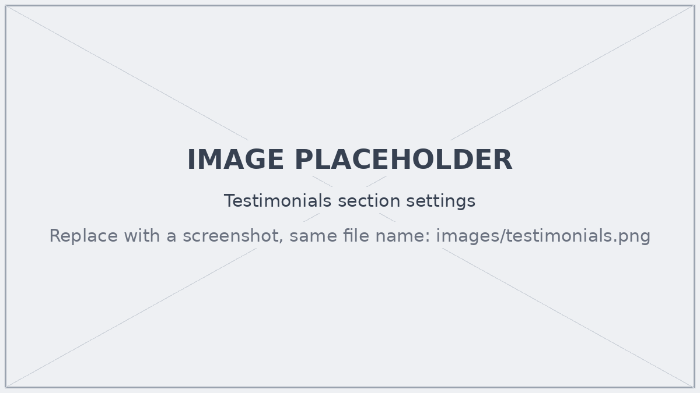
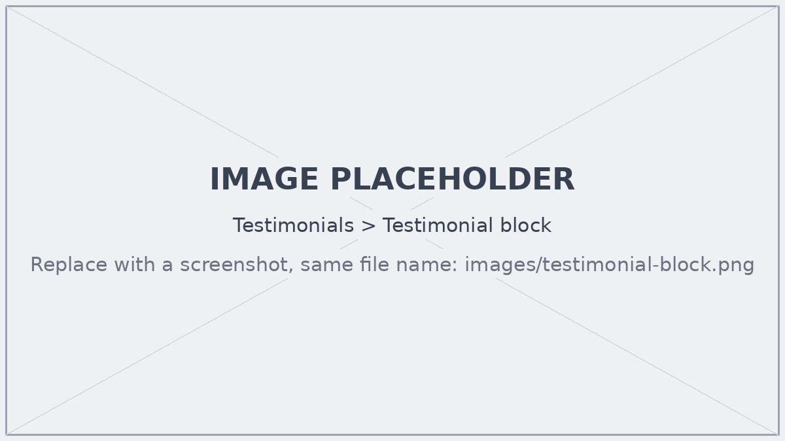

# Testimonials

Displays customer quotes in a slider over a background image, with optional logo, author, and auto-rotation.

## How to access

1. **Go to** Shopify Admin → Online Store → Themes.
2. **Click** Customize on your active theme.
3. Open a page such as **Home page** from the page picker.
4. Click **Add section** and choose **Testimonials**, or select an existing Testimonials section.

### Section Settings

| Setting | Description |
| ------- | ----------- |
| Layout |  |
| Width | Sets the width. Choose from Page or Full. |
| Aspect ratio | Sets the aspect ratio. Choose from Auto, Landscape, or Portrait. |
| Media height | Sets the media height. Choose from Auto, Small, Medium, or Large. Available when Aspect ratio is Auto. |
| Content width | Sets the maximum width of the quote. Range: 400–1200 px. |
| Alignment | Sets the text alignment. Choose from Left, Center, or Right. |
| Corner radius | Sets the corner radius. Range: 0–50 px. |
| Quote typography |  |
| Preset | Sets the quote typography preset. Choose from Default, Paragraph, Heading 1, Heading 2, Heading 3, Heading 4, Heading 5, Heading 6, or Custom. Edit presets in theme settings. |
| Font | Sets the font. Choose from Body, Subheading, Heading, or Accent. Available when Preset is Custom. |
| Size | Sets the size. Choose from Default, 10px up to 184px. Available when Preset is Custom. |
| Line height | Sets the line height. Choose from Tight, Normal, or Loose. Available when Preset is Custom. |
| Letter spacing | Sets the letter spacing. Choose from Tight, Normal, or Loose. Available when Preset is Custom. |
| Case | Sets the case. Choose from Default or Uppercase. Available when Preset is Custom. |
| Wrap | Sets the text wrap. Choose from Pretty, Balance, or None. Available when Preset is Custom. |
| Show quote icon | Shows or hides the quote icon above the quote. |
| Quote icon size | Sets the quote icon size. Range: 24–120 px. Available when Show quote icon is on. |
| Author typography |  |
| Preset | Sets the author typography preset. Choose from Paragraph, Heading 4, Heading 5, or Heading 6. Edit presets in theme settings. |
| Logo size | Sets the logo size. Choose from Auto, Small, Medium, or Large. |
| Appearance |  |
| Image | Selects the background image. |
| Text color | Sets the text color. |
| Media overlay | Enables or disables the media overlay. |
| Overlay color | Sets the overlay color. Supports transparency. Available when Media overlay is on. |
| Overlay style | Sets the overlay style. Choose from Solid or Gradient. Available when Media overlay is on. |
| Gradient direction | Sets the gradient direction. Choose from Up or Down. Available when Overlay style is Gradient. |
| Navigation |  |
| Pagination | Sets the pagination style. Choose from None, Dots, or Counter. |
| Pagination color | Sets the pagination color. Available when Pagination is Dots or Counter. |
| Icons | Sets the navigation icons. Choose from None, Arrows, Chevrons, Large arrows, or Large chevrons. |
| Auto-rotate slides | Turns on automatic rotation of the testimonials. |
| Speed | Sets the time each testimonial shows. Range: 3–10 s. Available when Auto-rotate slides is on. |
| Padding |  |
| Top | Sets the top padding. Range: 0–100 px. |
| Bottom | Sets the bottom padding. Range: 0–100 px. |


Add one **Testimonial** block per quote. Visitors move between quotes with the pagination dots or counter, and with the navigation icons if you turn them on.


### Blocks

Add blocks to this section in the theme editor. Each block is a separate item you can add, remove, and reorder.

#### Testimonial

Adds a quote with an optional logo and author.

| Setting | Description |
| ------- | ----------- |
| Quote | Sets the testimonial text. Rich text. |
| Logo | Selects an optional logo shown under the quote. Use a transparent PNG or SVG for best results. |
| Author name | Sets the author name. |
| Role or publication | Sets the author role or publication. Shown after the name, for example "Arjun M, Verified Buyer". |
